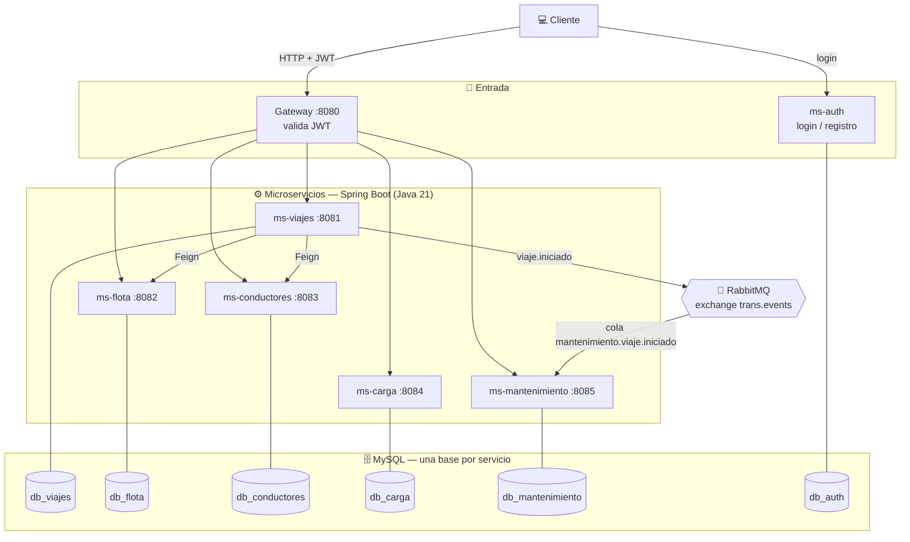
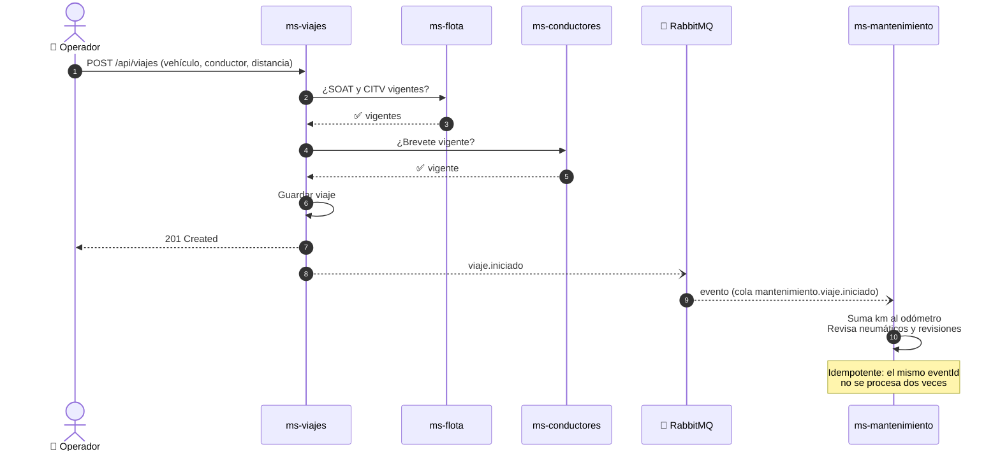
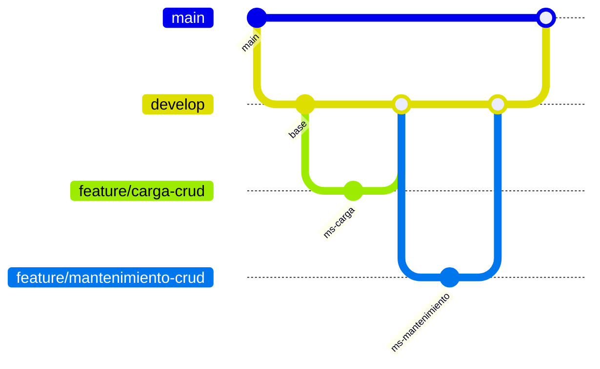

<div align="center">

# 🚛 TRANS-CARGO ERP

### Sistema de Gestión de Transporte de Carga basado en Microservicios

*Proyecto aplicativo (EF) — PROG5401 Desarrollo de Servicios Web II — Cibertec*

<br/>

<a href="https://skillicons.dev">
  
</a>

<br/><br/>


</div>

---

## 📑 Contenido

- [¿Qué resuelve?](#-qué-resuelve)
- [Microservicios](#-microservicios)
- [Arquitectura](#-arquitectura)
- [Estructura del repositorio](#-estructura-del-repositorio)
- [Cómo levantar el proyecto](#-cómo-levantar-el-proyecto)
- [API — Viajes, Mantenimiento y Carga](#-api--viajes-mantenimiento-y-carga)
- [Flujo de trabajo con Git](#-flujo-de-trabajo-con-git)
- [Equipo](#-equipo)
- [Roadmap](#-roadmap)

---

## 🎯 ¿Qué resuelve?

Las empresas de transporte de carga suelen llevar flota, conductores, viajes y
mantenimiento en **hojas de cálculo o cuadernos separados**, lo que genera:

| ❌ Problema | ✅ Solución con TRANS-CARGO ERP |
|---|---|
| Vehículos que salen a ruta con SOAT o revisión técnica vencidos | Antes de crear un viaje se consulta a **ms-flota** y se valida SOAT y CITV |
| Conductores con brevete vencido | **ms-conductores** valida el brevete antes de asignar el viaje |
| Mantenimiento que se olvida o llega tarde | Cada viaje alimenta el **odómetro** y alerta cuando un neumático o una revisión está por vencer |
| Mercadería sin respaldo del peso real | **ms-carga** registra pesajes, mercancías y guías de remisión |
| Un sistema único que se rompe por completo si falla una parte | Cada módulo es un **microservicio independiente** con su propia base de datos |
| Accesos sin control | Login con **JWT** validado en el gateway |

---

## 🧩 Microservicios

| Servicio | Puerto | Responsabilidad | Arquitectura | Estado |
|---|:---:|---|---|:---:|
| 🚪 **gateway** | `8080` | Punto de entrada único, valida el JWT y enruta | Spring Cloud Gateway + Spring Security | ✅ |
| 🧭 **ms-viajes** | `8081` | Núcleo del negocio: crea y controla los viajes, valida con flota y conductores, publica `viaje.iniciado` | Hexagonal | ✅ |
| 🚚 **ms-flota** | `8082` | Vehículos, SOAT y revisión técnica (CITV) | Capas | ✅ |
| 🧑‍✈️ **ms-conductores** | `8083` | Conductores y vigencia del brevete | Capas | ✅ |
| 📦 **ms-carga** | `8084` | Pesajes, mercancías y guías de remisión | Hexagonal | ✅ |
| 🔧 **ms-mantenimiento** | `8085` | Odómetro, neumáticos y revisiones; consume el evento de viajes | Hexagonal | ✅ |
| 🔐 **ms-auth** | `8086` | Registro, login, BCrypt y emisión de JWT | Capas | ✅ |

<sub>✅ Funcional · 🚧 En progreso · 📝 Planificado</sub>

> 💡 **¿Por qué dos arquitecturas?** `ms-viajes`, `ms-carga` y `ms-mantenimiento`
> tienen reglas de negocio y dependencias externas (otros servicios y mensajería),
> por eso usan **hexagonal**: el dominio queda aislado de Spring, JPA y RabbitMQ.
> `ms-flota`, `ms-conductores` y `ms-auth` son catálogos CRUD sencillos, donde la
> arquitectura en **capas** es suficiente.

---

## 🏗️ Arquitectura

Cada microservicio es una aplicación **Spring Boot** independiente, con su propio
puerto y su propia base de datos **MySQL**. Se comunican de dos formas:

- **Síncrona (OpenFeign):** `ms-viajes` pregunta a `ms-flota` por el SOAT/CITV y a `ms-conductores` por el brevete.
- **Asíncrona (RabbitMQ):** `ms-viajes` publica `viaje.iniciado` y `ms-mantenimiento` lo consume sin que el viaje tenga que esperarlo.



### 🔄 Flujo de un viaje

Un viaje solo se inicia si el vehículo y el conductor están en regla. Al iniciarse,
el mantenimiento se entera **sin acoplarse** al servicio de viajes.



### 🧱 Hexagonal: cómo se organiza un servicio

```text
org.transporte.<modulo>/
├── domian/                    # Núcleo: no depende de Spring ni de JPA
│   ├── bean/                  # Datos del negocio
│   ├── constraints/           # Reglas de validación (constantes)
│   ├── enums/                 # Estados y tipos
│   └── model/                 # Reglas de negocio y excepciones
├── application/               # Casos de uso
│   ├── port/in/               # Lo que el servicio ofrece
│   ├── port/out/              # Lo que el servicio necesita
│   └── service/               # Implementación de los casos de uso
└── infrastructure/            # Lo externo: web, BD, mensajería
    ├── client/                # Clientes Feign
    ├── configuration/         # ModelMapper, RabbitMQ
    ├── controller/            # REST + DTOs
    ├── messaging/             # Publicadores y consumidores
    └── persistence/           # entity · repository · adapter
```

La regla de oro: **`domian` y `application` nunca importan nada de `infrastructure`**.

### 🧰 Stack tecnológico

| Capa | Tecnología |
|---|---|
| **Backend** | Java 21 · Spring Boot 3.3 · Spring Data JPA · Bean Validation · Lombok · ModelMapper |
| **Comunicación** | OpenFeign (síncrona) · RabbitMQ (asíncrona) |
| **Seguridad** | Spring Security · JWT · BCrypt |
| **Base de datos** | MySQL (una base por servicio) |
| **Build** | Maven (wrapper incluido en los módulos) |
| **Contenedores** | Docker · Docker Compose |
| **Pruebas** | JUnit 5 · Mockito |

---

## 📁 Estructura del repositorio

```text
trans-cargo-erp/
├── README.md
├── docker/                      # MySQL + RabbitMQ (docker-compose y script de bases)
├── ms-auth/                     # Login, registro y JWT
├── ms-flota/                    # Vehículos, SOAT y CITV
├── ms-conductores/              # Conductores y brevete
├── ms-carga/                    # Pesajes, mercancías y guías de remisión
├── ms-mantenimiento/            # Odómetro, neumáticos y revisiones
├── ms-viajes/                   # Núcleo de viajes
└── gateway/                     # Entrada única con JWT
```

---

## 🚀 Cómo levantar el proyecto

### Requisitos

- ☕ **JDK 21**
- 🐳 **Docker Desktop**
- 🔧 Git

### 1. Clonar el repositorio

```bash
git clone https://github.com/MichaelLunaDev/trans-cargo-erp.git
cd trans-cargo-erp
```

### 2. Levantar MySQL y RabbitMQ

```bash
cd docker
docker compose up -d
```

| Servicio | Dirección | Credenciales |
|---|---|---|
| MySQL | `localhost:3307` | `root` / `root` |
| RabbitMQ | `localhost:5672` | `guest` / `guest` |
| Panel de RabbitMQ | http://localhost:15672 | `guest` / `guest` |

El script `docker/init-databases.sql` crea automáticamente las bases
`db_auth`, `db_flota`, `db_conductores`, `db_viajes`, `db_carga` y `db_mantenimiento`.

> ⚠️ Estas credenciales son **solo para desarrollo local**.

### 3. Ejecutar un microservicio

Cada servicio se levanta por separado desde su carpeta. Ejemplo con mantenimiento:

```bash
cd ms-mantenimiento
./mvnw spring-boot:run          # Linux / macOS
.\mvnw.cmd spring-boot:run      # Windows
```

### 4. Ejecutar las pruebas

```bash
./mvnw test
```

---

## 🔧 API — Viajes, Mantenimiento y Carga

| Método | Endpoint | Descripción |
|:---:|---|---|
|  | `/api/viajes` | Programa un viaje (valida vehículo y conductor) |
|  | `/api/viajes/{id}/iniciar` | Inicia el viaje y publica `viaje.iniciado` |
|  | `/api/viajes/{id}/finalizar` | Finaliza el viaje |
|  | `/api/viajes/{id}/cancelar` | Cancela un viaje programado |
|  | `/api/viajes` | Lista viajes (filtros `estado` y `vehiculoId`) |
|  | `/api/mantenimiento/odometros/{vehiculoId}` | Odómetro acumulado de un vehículo |
|  | `/api/mantenimiento/neumaticos` | Registra un neumático |
|  | `/api/mantenimiento/revisiones` | Programa una revisión |
|  | `/api/mantenimiento/revisiones/vencidas` | Lista las revisiones vencidas |
|  | `/api/carga/pesajes` | Registra un pesaje |

<details>
<summary><b>📨 Ejemplo: registrar un neumático</b></summary>

```json
POST http://localhost:8085/api/mantenimiento/neumaticos
{
  "vehiculoId": 7,
  "posicion": "DEL-IZQ",
  "vidaUtilKm": 100000
}
```

</details>

<details>
<summary><b>🐇 Ejemplo: simular el evento de un viaje</b></summary>

Contrato del evento `viaje.iniciado`:

```json
{
  "eventId": "3f1c2a9e-8b7d-4c1e-9a2f-1d2e3f4a5b6c",
  "viajeId": 10,
  "vehiculoId": 7,
  "placa": "ABC-123",
  "distanciaKm": 350.5,
  "fecha": "2026-10-10T08:30:00"
}
```

Se publica en el exchange `trans.events` con la clave `viaje.iniciado`.
Si se envía dos veces el mismo `eventId`, los kilómetros se suman **una sola vez**.

</details>

---

## 🌿 Flujo de trabajo con Git



| Rama | Uso |
|---|---|
| `main` | Versión estable de entrega |
| `develop` | Integración de los módulos |
| `feature/*` | Una rama por módulo, trabajada por su responsable |

Los merges se hacen con `--no-ff` para conservar el historial de cada módulo.

---

## 👥 Equipo

| Integrante | Módulo |
|---|---|
| **MichaelLunaDev** | ms-auth · ms-viajes · gateway · Docker · coordinación |
| **derManMan** | ms-flota |
| **Jhosep2102** | ms-conductores |
| **brayan390-cloud** | ms-carga |
| **Nayelii7** | ms-mantenimiento |

---

## 🗺️ Roadmap

- [x] Infraestructura con Docker (MySQL + RabbitMQ)
- [x] ms-auth con login, BCrypt y JWT
- [x] ms-flota y ms-conductores (CRUD)
- [x] ms-carga con arquitectura hexagonal
- [x] ms-mantenimiento con consumo de eventos idempotente
- [x] ms-viajes con Feign hacia flota y conductores
- [x] Publicación del evento `viaje.iniciado` desde ms-viajes
- [x] Gateway con validación de JWT
- [ ] Todos los servicios dentro de Docker Compose
- [ ] Informe, presentación y entrega final

---

<div align="center">


</div>